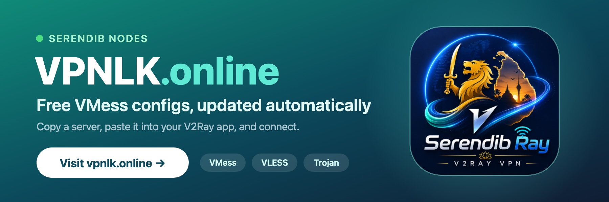

<!-- README.md is generated. Edit templates/README.template.md, not README.md. -->
<div align="center">

<a href="https://vpnlk.online/">
  
</a>

# Free VMess Configs and V2Ray Servers (2026), Auto Updated

[](https://vpnlk.online/)
[](https://play.google.com/store/apps/details?id=dev.dinith.serendibray.serendibray)
[](https://t.me/vpnlkV2ray)

 

</div>

A **free VMess config list** from [**VPNLK.online**](https://vpnlk.online/), updated automatically. Copy a `vmess://` V2Ray config, or add the **free V2Ray subscription link** to v2rayNG, v2rayN or V2Box. On Android you can also use [**Serendib Ray**](https://play.google.com/store/apps/details?id=dev.dinith.serendibray.serendibray), a free V2Ray VPN app with free servers built in.

<div align="center">

**🌐 Working servers on vpnlk.online**

### [VLESS 492](https://vpnlk.online/type/vless) &nbsp;|&nbsp; [VMess 241](https://vpnlk.online/type/vmess) &nbsp;|&nbsp; [Trojan 8](https://vpnlk.online/type/trojan) &nbsp;|&nbsp; [Shadowsocks 224](https://vpnlk.online/type/shadowsocks)

[VMess configs](#-latest-free-vmess-configs) &nbsp;•&nbsp;
[Subscription link](#-free-vmess-subscription-link) &nbsp;•&nbsp;
[Android app](#-serendib-ray-free-v2ray-vpn-app-for-android) &nbsp;•&nbsp;
[How to use](#-how-to-use-a-vmess-config) &nbsp;•&nbsp;
[FAQ](#-faq) &nbsp;•&nbsp;
[සිංහල / தமிழ்](#-සිංහල-සහ-தமிழ்)

<table>
  <tr>
    <td align="center" width="130">
      <a href="https://play.google.com/store/apps/details?id=dev.dinith.serendibray.serendibray"></a>
    </td>
    <td>
      <b>Serendib Ray: free V2Ray VPN app for Android</b><br>
      Free servers built in, or paste your own VMess, VLESS, Trojan or Shadowsocks link.
    </td>
    <td align="center" width="210">
      <a href="https://play.google.com/store/apps/details?id=dev.dinith.serendibray.serendibray"></a>
    </td>
  </tr>
</table>

</div>

---

## 🔗 Free VMess subscription link

Add this URL as a subscription in **v2rayNG**, **v2rayN** or **V2Box**. Update the subscription in the app to pull the newest list.

```text
https://raw.githubusercontent.com/VPNLK-online/VPNLK.online/main/configs/vmess-sub.txt
```

## 🚀 Latest free VMess configs

**17 free VMess configs** on this page &nbsp;·&nbsp; last changed **27 Nov 2026, 15:34 UTC**

> 🌐 This page shows **17**. The website lists **241 working VMess servers**: **[see them all on vpnlk.online/type/vmess](https://vpnlk.online/type/vmess)**

<sub>🇸🇬 Singapore <b>15</b> &nbsp;·&nbsp; 🇹🇭 Thailand <b>1</b> &nbsp;·&nbsp; 🇮🇳 India <b>1</b></sub>

<details>
<summary><b>📋 Copy all 17 configs at once</b></summary>

```text
vmess://eyJhZGQiOiIxNDkuODguMjMuMjA3IiwiYWlkIjowLCJob3N0IjoiIiwiaWQiOiJmOGM4ZGMzZC0wZDM3LTQ2YjAtOGIzNC1hNzIzMjg4MmZjZmUiLCJuZXQiOiJ0Y3AiLCJwYXRoIjoiIiwicG9ydCI6IjE4MDAwIiwicHMiOiLwn4e48J+HrCBWUE5MSy5vbmxpbmUgfCBTaW5nYXBvcmUgIzAxIiwic25pIjoiMTQ5Ljg4LjIzLjIwNyIsInRscyI6IiIsInR5cGUiOiJub25lIiwidiI6IjIifQ==
vmess://eyJhZGQiOiJ3dzExLmxldmlrb2dqZ2ZkZC5pciIsImFpZCI6MCwiaG9zdCI6IiIsImlkIjoiZjhjOGRjM2QtMGQzNy00NmIwLThiMzQtYTcyMzI4ODJmY2ZlIiwibmV0IjoidGNwIiwicGF0aCI6IiIsInBvcnQiOiIxODAwMCIsInBzIjoi8J+HuPCfh6wgVlBOTEsub25saW5lIHwgU2luZ2Fwb3JlICMwMiIsInNuaSI6Ind3MTEubGV2aWtvZ2pnZmRkLmlyIiwidGxzIjoiIiwidHlwZSI6Im5vbmUiLCJ2IjoiMiJ9
vmess://eyJ2IjoiMiIsInBzIjoi8J+HuPCfh6wgVlBOTEsub25saW5lIHwgU2luZ2Fwb3JlICMwMyIsImFkZCI6IjE0OS44OC4yMy4yMDciLCJwb3J0IjoiMTgwMDAiLCJpZCI6ImY4YzhkYzNkLTBkMzctNDZiMC04YjM0LWE3MjMyODgyZmNmZSIsImFpZCI6IjAiLCJzY3kiOiJhdXRvIiwibmV0IjoidGNwIiwidHlwZSI6Im5vbmUiLCJob3N0IjoiLz9UZWxlZ3JhbS0tLVBMQU5CX05FVC0tLVBMQU5CX05FVC0tLVBMQU5CX05FVC0tLVBMQU5CX05FVCIsInBhdGgiOiIiLCJ0bHMiOiJub25lIiwic25pIjoiIiwiYWxwbiI6IiIsImZwIjoiIiwiaW5zZWN1cmUiOiIiLCJwY3MiOiIiLCJ2Y24iOiIiLCJlY2giOiIiLCJwcXYiOiIifQ==
vmess://eyJ2IjpudWxsLCJwcyI6IvCfh7jwn4esIFZQTkxLLm9ubGluZSB8IFNpbmdhcG9yZSAjMDQiLCJhZGQiOiJ3dzExLmxldmlrb2dqZ2ZkZC5pciIsInBvcnQiOjE4MDAwLCJpZCI6ImY4YzhkYzNkLTBkMzctNDZiMC04YjM0LWE3MjMyODgyZmNmZSIsImFpZCI6IjAiLCJzY3kiOiJhdXRvIiwibmV0IjoidGNwIiwidHlwZSI6bnVsbCwiaG9zdCI6Ind3MTEubGV2aWtvZ2pnZmRkLmlyIiwiYWxwbiI6bnVsbCwicGF0aCI6Ii8iLCJ0bHMiOiJub25lIiwic25pIjpudWxsLCJmcCI6bnVsbCwibmFtZSI6IlNHIPCfh7jwn4esIHwgQFJheWRpa2FseCB8IDNBRDM2MyJ9
vmess://eyJhZGQiOiIxNDkuODguMjMuMjAyIiwiYWlkIjoiMCIsImhvc3QiOiIiLCJpZCI6ImY4YzhkYzNkLTBkMzctNDZiMC04YjM0LWE3MjMyODgyZmNmZSIsIm5hdGlvbiI6IiIsIm5ldCI6InRjcCIsInBhdGgiOiIiLCJwb3J0IjoxODAwMCwicHMiOiLwn4e48J+HrCBWUE5MSy5vbmxpbmUgfCBTaW5nYXBvcmUgIzA1Iiwic2N5IjoiYXV0byIsInNlcnZlclBvcnQiOjAsInNuaSI6IiIsInRscyI6Im5vbmUiLCJ0eXBlIjoibm9uZSIsInYiOiIyIiwic2tpcC1jZXJ0LXZlcmlmeSI6dHJ1ZSwibmFtZSI6IlNHIPCfh7jwn4esIHwgQFJheWRpa2FseCB8IDhFRUUwOSJ9
vmess://eyJhZGQiOiJ3dzExLmxldmlrb2dqZ2ZkZC5pciIsImFpZCI6MCwiaG9zdCI6IiIsImlkIjoiZjhjOGRjM2QtMGQzNy00NmIwLThiMzQtYTcyMzI4ODJmY2ZlIiwibmV0IjoidGNwIiwicGF0aCI6Ii80YmMwMjdhNDQ1MzIiLCJwb3J0IjoiMTgwMDAiLCJwcyI6IvCfh7jwn4esIFZQTkxLLm9ubGluZSB8IFNpbmdhcG9yZSAjMDYiLCJzbmkiOiIiLCJ0bHMiOiIiLCJ0eXBlIjoibm9uZSIsInYiOiIyIn0=
vmess://eyJhZGQiOiIxNDkuODguMjMuMjAyIiwiYWlkIjowLCJob3N0IjoiMTQ5Ljg4LjIzLjIwMiIsImlkIjoiZjhjOGRjM2QtMGQzNy00NmIwLThiMzQtYTcyMzI4ODJmY2ZlIiwibmV0IjoidGNwIiwicGF0aCI6IiIsInBvcnQiOiIxODAwMCIsInBzIjoi8J+HuPCfh6wgVlBOTEsub25saW5lIHwgU2luZ2Fwb3JlICMwNyIsInNuaSI6IjE0OS44OC4yMy4yMDIiLCJ0bHMiOiIiLCJ0eXBlIjoibm9uZSIsInYiOiIyIn0=
vmess://eyJhZGQiOiJ3dzExLmxldmlrb2dqZ2ZkZC5pciIsImFpZCI6IjAiLCJhbHBuIjoiIiwiZnAiOiIiLCJob3N0IjoiVGVsZWdyYW0taTEwVlBOIiwiaWQiOiJmOGM4ZGMzZC0wZDM3LTQ2YjAtOGIzNC1hNzIzMjg4MmZjZmUiLCJpbnNlY3VyZSI6IjAiLCJuZXQiOiJ0Y3AiLCJwYXRoIjoiIiwicGNzIjoiIiwicG9ydCI6IjE4MDAwIiwicHMiOiLwn4e48J+HrCBWUE5MSy5vbmxpbmUgfCBTaW5nYXBvcmUgIzA4Iiwic2N5IjoiYXV0byIsInNuaSI6IiIsInRscyI6IiIsInR5cGUiOiJub25lIiwidiI6IjIiLCJ2Y24iOiIifQ==
vmess://eyJ2IjpudWxsLCJwcyI6IvCfh7jwn4esIFZQTkxLLm9ubGluZSB8IFNpbmdhcG9yZSAjMDkiLCJhZGQiOiIxNDkuODguMjMuMjAyIiwicG9ydCI6MTgwMDAsImlkIjoiZjhjOGRjM2QtMGQzNy00NmIwLThiMzQtYTcyMzI4ODJmY2ZlIiwiYWlkIjoiMCIsInNjeSI6ImF1dG8iLCJuZXQiOiJ0Y3AiLCJ0eXBlIjpudWxsLCJob3N0IjoiIiwiYWxwbiI6bnVsbCwicGF0aCI6Ii8iLCJ0bHMiOiJub25lIiwic25pIjpudWxsLCJmcCI6bnVsbCwibmFtZSI6IlNHIPCfh7jwn4esIHwgQFJheWRpa2FseCB8IDhFRUUwOSJ9
vmess://eyJ2IjpudWxsLCJwcyI6IvCfh7jwn4esIFZQTkxLLm9ubGluZSB8IFNpbmdhcG9yZSAjMTAiLCJhZGQiOiIxNDkuODguMjMuMjA3IiwicG9ydCI6MTgwMDAsImlkIjoiZjhjOGRjM2QtMGQzNy00NmIwLThiMzQtYTcyMzI4ODJmY2ZlIiwiYWlkIjoiMCIsInNjeSI6ImF1dG8iLCJuZXQiOiJ0Y3AiLCJ0eXBlIjpudWxsLCJob3N0Ijoid3cxMS5sZXZpa29namdmZGQuaXIiLCJhbHBuIjpudWxsLCJwYXRoIjoiLyIsInRscyI6Im5vbmUiLCJzbmkiOm51bGwsImZwIjpudWxsLCJuYW1lIjoiU0cg8J+HuPCfh6wgfCBAUmF5ZGlrYWx4IHwgQ0FGMzRGIn0=
vmess://eyJhZGQiOiJ3dzExLmxldmlrb2dqZ2ZkZC5pciIsImFpZCI6IjAiLCJhbHBuIjoiIiwiZnAiOiIiLCJob3N0IjoiVGVsZWdyYW0tTGV2aWtvX3YycmF5IiwiaWQiOiJmOGM4ZGMzZC0wZDM3LTQ2YjAtOGIzNC1hNzIzMjg4MmZjZmUiLCJpbnNlY3VyZSI6IjAiLCJuZXQiOiJ0Y3AiLCJwYXRoIjoiIiwicGNzIjoiIiwicG9ydCI6IjE4MDAwIiwicHMiOiLwn4e48J+HrCBWUE5MSy5vbmxpbmUgfCBTaW5nYXBvcmUgIzExIiwic2N5IjoiYXV0byIsInNuaSI6IiIsInRscyI6IiIsInR5cGUiOiJub25lIiwidiI6IjIiLCJ2Y24iOiIifQ==
vmess://eyJhZGQiOiIxNDkuODguMjMuMjA3IiwiYWlkIjoiMCIsImFscG4iOiIiLCJmcCI6IiIsImhvc3QiOiIiLCJpZCI6ImY4YzhkYzNkLTBkMzctNDZiMC04YjM0LWE3MjMyODgyZmNmZSIsIm5ldCI6InRjcCIsInBhdGgiOiIvIiwicG9ydCI6IjE4MDAwIiwicHMiOiLwn4e48J+HrCBWUE5MSy5vbmxpbmUgfCBTaW5nYXBvcmUgIzEyIiwic2N5IjoiYXV0byIsInNuaSI6IiIsInRscyI6IiIsInR5cGUiOiJub25lIiwidiI6IjIifQ==
vmess://eyJhZGQiOiIxNDkuODguMjMuMjA3IiwiYWlkIjowLCJob3N0IjoiMTQ5Ljg4LjIzLjIwNyIsImlkIjoiZjhjOGRjM2QtMGQzNy00NmIwLThiMzQtYTcyMzI4ODJmY2ZlIiwibmV0IjoidGNwIiwicGF0aCI6IiIsInBvcnQiOiIxODAwMCIsInBzIjoi8J+HuPCfh6wgVlBOTEsub25saW5lIHwgU2luZ2Fwb3JlICMxMyIsInNuaSI6IjE0OS44OC4yMy4yMDciLCJ0bHMiOiIiLCJ0eXBlIjoibm9uZSIsInYiOiIyIn0=
vmess://eyJ2IjoiMiIsInBzIjoi8J+HuPCfh6wgVlBOTEsub25saW5lIHwgU2luZ2Fwb3JlICMxNCIsImFkZCI6IjE5NS4xMzMuMTM1LjIzOCIsInBvcnQiOiIxMDA4NiIsInR5cGUiOiJub25lIiwiaWQiOiJiODMxMzgxZC02MzI0LTRkNTMtYWQ0Zi04Y2RhNDhiMzA4MTEiLCJhaWQiOiIwIiwibmV0IjoidGNwIiwicGF0aCI6Ii8iLCJob3N0IjoiIiwidGxzIjoiIiwic2N5IjoiYXV0byIsInNuaSI6IiIsImFscG4iOiIiLCJmcCI6IiJ9
vmess://eyJ2IjoiMiIsInBzIjoi8J+HuPCfh6wgVlBOTEsub25saW5lIHwgU2luZ2Fwb3JlICMxNSIsImFkZCI6IjE5NS4xMzMuMTM1LjIzOCIsInBvcnQiOiIxMDA4NiIsImlkIjoiYjgzMTM4MWQtNjMyNC00ZDUzLWFkNGYtOGNkYTQ4YjMwODExIiwiYWlkIjoiMCIsInNjeSI6ImF1dG8iLCJuZXQiOiJ0Y3AiLCJ0eXBlIjoibm9uZSIsImhvc3QiOiIiLCJwYXRoIjoiIiwidGxzIjoiIiwic25pIjoiIiwiYWxwbiI6IiIsImNzIjoiIiwiZnAiOiIiLCJpbnNlY3VyZSI6IiJ9
vmess://eyJhZGQiOiIxMTkuNDYuNTEuNDUiLCJhaWQiOiIwIiwiYWxwbiI6bnVsbCwiZnAiOm51bGwsImhvc3QiOm51bGwsImlkIjoiOWI3NmJjMzEtMTdhNS00NDU0LTkzNGEtOGQ1ZmI2MDJjZDcwIiwibmFtZSI6IlRIIPCfh7nwn4etIHwgQFJheWRpa2FseCB8IDg2RkY3NiIsIm5ldCI6InRjcCIsInBhdGgiOiIvIiwicG9ydCI6Mzc1MTUsInBzIjoi8J+HufCfh60gVlBOTEsub25saW5lIHwgVGhhaWxhbmQgIzE2Iiwic2N5IjoiYXV0byIsInNuaSI6bnVsbCwidGxzIjoibm9uZSIsInR5cGUiOm51bGwsInYiOm51bGx9
vmess://eyJhZGQiOiIxNTIuNjcuOC4yMDUiLCJhaWQiOjAsImhvc3QiOiJpbi0xNTIuNjcuOC4yMDUtMDE3OSIsImlkIjoiOWRiNGM3MDgtYWVmOC00MzU5LTgyMWItMzhlNDc5OTBiZTBkIiwibmV0Ijoid3MiLCJwYXRoIjoiIiwicG9ydCI6IjgwIiwicHMiOiLwn4eu8J+HsyBWUE5MSy5vbmxpbmUgfCBJbmRpYSAjMTciLCJzbmkiOiIiLCJ0bHMiOiIiLCJ0eXBlIjoibm9uZSIsInYiOiIyIn0=
```

</details>

### Copy a single V2Ray VMess server

Open a row, then press the copy button at the top right of the box.

<details>
<summary><b>#01</b>&nbsp; 🇸🇬 <b>Singapore</b> &nbsp;·&nbsp; <code>tcp</code> <code>no TLS</code> &nbsp;·&nbsp; port <code>18000</code> &nbsp;·&nbsp; ⚡ 1 Gbps+ &nbsp;·&nbsp; 📶 7 ms</summary>

```text
vmess://eyJhZGQiOiIxNDkuODguMjMuMjA3IiwiYWlkIjowLCJob3N0IjoiIiwiaWQiOiJmOGM4ZGMzZC0wZDM3LTQ2YjAtOGIzNC1hNzIzMjg4MmZjZmUiLCJuZXQiOiJ0Y3AiLCJwYXRoIjoiIiwicG9ydCI6IjE4MDAwIiwicHMiOiLwn4e48J+HrCBWUE5MSy5vbmxpbmUgfCBTaW5nYXBvcmUgIzAxIiwic25pIjoiMTQ5Ljg4LjIzLjIwNyIsInRscyI6IiIsInR5cGUiOiJub25lIiwidiI6IjIifQ==
```

</details>

<details>
<summary><b>#02</b>&nbsp; 🇸🇬 <b>Singapore</b> &nbsp;·&nbsp; <code>tcp</code> <code>no TLS</code> &nbsp;·&nbsp; port <code>18000</code> &nbsp;·&nbsp; ⚡ 1 Gbps+ &nbsp;·&nbsp; 📶 8 ms</summary>

```text
vmess://eyJhZGQiOiJ3dzExLmxldmlrb2dqZ2ZkZC5pciIsImFpZCI6MCwiaG9zdCI6IiIsImlkIjoiZjhjOGRjM2QtMGQzNy00NmIwLThiMzQtYTcyMzI4ODJmY2ZlIiwibmV0IjoidGNwIiwicGF0aCI6IiIsInBvcnQiOiIxODAwMCIsInBzIjoi8J+HuPCfh6wgVlBOTEsub25saW5lIHwgU2luZ2Fwb3JlICMwMiIsInNuaSI6Ind3MTEubGV2aWtvZ2pnZmRkLmlyIiwidGxzIjoiIiwidHlwZSI6Im5vbmUiLCJ2IjoiMiJ9
```

</details>

<details>
<summary><b>#03</b>&nbsp; 🇸🇬 <b>Singapore</b> &nbsp;·&nbsp; <code>tcp</code> <code>no TLS</code> &nbsp;·&nbsp; port <code>18000</code> &nbsp;·&nbsp; ⚡ 1 Gbps+ &nbsp;·&nbsp; 📶 9 ms</summary>

```text
vmess://eyJ2IjoiMiIsInBzIjoi8J+HuPCfh6wgVlBOTEsub25saW5lIHwgU2luZ2Fwb3JlICMwMyIsImFkZCI6IjE0OS44OC4yMy4yMDciLCJwb3J0IjoiMTgwMDAiLCJpZCI6ImY4YzhkYzNkLTBkMzctNDZiMC04YjM0LWE3MjMyODgyZmNmZSIsImFpZCI6IjAiLCJzY3kiOiJhdXRvIiwibmV0IjoidGNwIiwidHlwZSI6Im5vbmUiLCJob3N0IjoiLz9UZWxlZ3JhbS0tLVBMQU5CX05FVC0tLVBMQU5CX05FVC0tLVBMQU5CX05FVC0tLVBMQU5CX05FVCIsInBhdGgiOiIiLCJ0bHMiOiJub25lIiwic25pIjoiIiwiYWxwbiI6IiIsImZwIjoiIiwiaW5zZWN1cmUiOiIiLCJwY3MiOiIiLCJ2Y24iOiIiLCJlY2giOiIiLCJwcXYiOiIifQ==
```

</details>

<details>
<summary><b>#04</b>&nbsp; 🇸🇬 <b>Singapore</b> &nbsp;·&nbsp; <code>tcp</code> <code>no TLS</code> &nbsp;·&nbsp; port <code>18000</code> &nbsp;·&nbsp; ⚡ 1 Gbps+ &nbsp;·&nbsp; 📶 9 ms</summary>

```text
vmess://eyJ2IjpudWxsLCJwcyI6IvCfh7jwn4esIFZQTkxLLm9ubGluZSB8IFNpbmdhcG9yZSAjMDQiLCJhZGQiOiJ3dzExLmxldmlrb2dqZ2ZkZC5pciIsInBvcnQiOjE4MDAwLCJpZCI6ImY4YzhkYzNkLTBkMzctNDZiMC04YjM0LWE3MjMyODgyZmNmZSIsImFpZCI6IjAiLCJzY3kiOiJhdXRvIiwibmV0IjoidGNwIiwidHlwZSI6bnVsbCwiaG9zdCI6Ind3MTEubGV2aWtvZ2pnZmRkLmlyIiwiYWxwbiI6bnVsbCwicGF0aCI6Ii8iLCJ0bHMiOiJub25lIiwic25pIjpudWxsLCJmcCI6bnVsbCwibmFtZSI6IlNHIPCfh7jwn4esIHwgQFJheWRpa2FseCB8IDNBRDM2MyJ9
```

</details>

<details>
<summary><b>#05</b>&nbsp; 🇸🇬 <b>Singapore</b> &nbsp;·&nbsp; <code>tcp</code> <code>no TLS</code> &nbsp;·&nbsp; port <code>18000</code> &nbsp;·&nbsp; ⚡ 1 Gbps+ &nbsp;·&nbsp; 📶 11 ms</summary>

```text
vmess://eyJhZGQiOiIxNDkuODguMjMuMjAyIiwiYWlkIjoiMCIsImhvc3QiOiIiLCJpZCI6ImY4YzhkYzNkLTBkMzctNDZiMC04YjM0LWE3MjMyODgyZmNmZSIsIm5hdGlvbiI6IiIsIm5ldCI6InRjcCIsInBhdGgiOiIiLCJwb3J0IjoxODAwMCwicHMiOiLwn4e48J+HrCBWUE5MSy5vbmxpbmUgfCBTaW5nYXBvcmUgIzA1Iiwic2N5IjoiYXV0byIsInNlcnZlclBvcnQiOjAsInNuaSI6IiIsInRscyI6Im5vbmUiLCJ0eXBlIjoibm9uZSIsInYiOiIyIiwic2tpcC1jZXJ0LXZlcmlmeSI6dHJ1ZSwibmFtZSI6IlNHIPCfh7jwn4esIHwgQFJheWRpa2FseCB8IDhFRUUwOSJ9
```

</details>

<details>
<summary><b>#06</b>&nbsp; 🇸🇬 <b>Singapore</b> &nbsp;·&nbsp; <code>tcp</code> <code>no TLS</code> &nbsp;·&nbsp; port <code>18000</code> &nbsp;·&nbsp; ⚡ 1 Gbps+ &nbsp;·&nbsp; 📶 11 ms</summary>

```text
vmess://eyJhZGQiOiJ3dzExLmxldmlrb2dqZ2ZkZC5pciIsImFpZCI6MCwiaG9zdCI6IiIsImlkIjoiZjhjOGRjM2QtMGQzNy00NmIwLThiMzQtYTcyMzI4ODJmY2ZlIiwibmV0IjoidGNwIiwicGF0aCI6Ii80YmMwMjdhNDQ1MzIiLCJwb3J0IjoiMTgwMDAiLCJwcyI6IvCfh7jwn4esIFZQTkxLLm9ubGluZSB8IFNpbmdhcG9yZSAjMDYiLCJzbmkiOiIiLCJ0bHMiOiIiLCJ0eXBlIjoibm9uZSIsInYiOiIyIn0=
```

</details>

<details>
<summary><b>#07</b>&nbsp; 🇸🇬 <b>Singapore</b> &nbsp;·&nbsp; <code>tcp</code> <code>no TLS</code> &nbsp;·&nbsp; port <code>18000</code> &nbsp;·&nbsp; ⚡ 1 Gbps+ &nbsp;·&nbsp; 📶 11 ms</summary>

```text
vmess://eyJhZGQiOiIxNDkuODguMjMuMjAyIiwiYWlkIjowLCJob3N0IjoiMTQ5Ljg4LjIzLjIwMiIsImlkIjoiZjhjOGRjM2QtMGQzNy00NmIwLThiMzQtYTcyMzI4ODJmY2ZlIiwibmV0IjoidGNwIiwicGF0aCI6IiIsInBvcnQiOiIxODAwMCIsInBzIjoi8J+HuPCfh6wgVlBOTEsub25saW5lIHwgU2luZ2Fwb3JlICMwNyIsInNuaSI6IjE0OS44OC4yMy4yMDIiLCJ0bHMiOiIiLCJ0eXBlIjoibm9uZSIsInYiOiIyIn0=
```

</details>

<details>
<summary><b>#08</b>&nbsp; 🇸🇬 <b>Singapore</b> &nbsp;·&nbsp; <code>tcp</code> <code>no TLS</code> &nbsp;·&nbsp; port <code>18000</code> &nbsp;·&nbsp; ⚡ 1 Gbps+ &nbsp;·&nbsp; 📶 11 ms</summary>

```text
vmess://eyJhZGQiOiJ3dzExLmxldmlrb2dqZ2ZkZC5pciIsImFpZCI6IjAiLCJhbHBuIjoiIiwiZnAiOiIiLCJob3N0IjoiVGVsZWdyYW0taTEwVlBOIiwiaWQiOiJmOGM4ZGMzZC0wZDM3LTQ2YjAtOGIzNC1hNzIzMjg4MmZjZmUiLCJpbnNlY3VyZSI6IjAiLCJuZXQiOiJ0Y3AiLCJwYXRoIjoiIiwicGNzIjoiIiwicG9ydCI6IjE4MDAwIiwicHMiOiLwn4e48J+HrCBWUE5MSy5vbmxpbmUgfCBTaW5nYXBvcmUgIzA4Iiwic2N5IjoiYXV0byIsInNuaSI6IiIsInRscyI6IiIsInR5cGUiOiJub25lIiwidiI6IjIiLCJ2Y24iOiIifQ==
```

</details>

<details>
<summary><b>#09</b>&nbsp; 🇸🇬 <b>Singapore</b> &nbsp;·&nbsp; <code>tcp</code> <code>no TLS</code> &nbsp;·&nbsp; port <code>18000</code> &nbsp;·&nbsp; ⚡ 1 Gbps+ &nbsp;·&nbsp; 📶 13 ms</summary>

```text
vmess://eyJ2IjpudWxsLCJwcyI6IvCfh7jwn4esIFZQTkxLLm9ubGluZSB8IFNpbmdhcG9yZSAjMDkiLCJhZGQiOiIxNDkuODguMjMuMjAyIiwicG9ydCI6MTgwMDAsImlkIjoiZjhjOGRjM2QtMGQzNy00NmIwLThiMzQtYTcyMzI4ODJmY2ZlIiwiYWlkIjoiMCIsInNjeSI6ImF1dG8iLCJuZXQiOiJ0Y3AiLCJ0eXBlIjpudWxsLCJob3N0IjoiIiwiYWxwbiI6bnVsbCwicGF0aCI6Ii8iLCJ0bHMiOiJub25lIiwic25pIjpudWxsLCJmcCI6bnVsbCwibmFtZSI6IlNHIPCfh7jwn4esIHwgQFJheWRpa2FseCB8IDhFRUUwOSJ9
```

</details>

<details>
<summary><b>#10</b>&nbsp; 🇸🇬 <b>Singapore</b> &nbsp;·&nbsp; <code>tcp</code> <code>no TLS</code> &nbsp;·&nbsp; port <code>18000</code> &nbsp;·&nbsp; ⚡ 1 Gbps+ &nbsp;·&nbsp; 📶 13 ms</summary>

```text
vmess://eyJ2IjpudWxsLCJwcyI6IvCfh7jwn4esIFZQTkxLLm9ubGluZSB8IFNpbmdhcG9yZSAjMTAiLCJhZGQiOiIxNDkuODguMjMuMjA3IiwicG9ydCI6MTgwMDAsImlkIjoiZjhjOGRjM2QtMGQzNy00NmIwLThiMzQtYTcyMzI4ODJmY2ZlIiwiYWlkIjoiMCIsInNjeSI6ImF1dG8iLCJuZXQiOiJ0Y3AiLCJ0eXBlIjpudWxsLCJob3N0Ijoid3cxMS5sZXZpa29namdmZGQuaXIiLCJhbHBuIjpudWxsLCJwYXRoIjoiLyIsInRscyI6Im5vbmUiLCJzbmkiOm51bGwsImZwIjpudWxsLCJuYW1lIjoiU0cg8J+HuPCfh6wgfCBAUmF5ZGlrYWx4IHwgQ0FGMzRGIn0=
```

</details>

<details>
<summary><b>#11</b>&nbsp; 🇸🇬 <b>Singapore</b> &nbsp;·&nbsp; <code>tcp</code> <code>no TLS</code> &nbsp;·&nbsp; port <code>18000</code> &nbsp;·&nbsp; ⚡ 1 Gbps+ &nbsp;·&nbsp; 📶 14 ms</summary>

```text
vmess://eyJhZGQiOiJ3dzExLmxldmlrb2dqZ2ZkZC5pciIsImFpZCI6IjAiLCJhbHBuIjoiIiwiZnAiOiIiLCJob3N0IjoiVGVsZWdyYW0tTGV2aWtvX3YycmF5IiwiaWQiOiJmOGM4ZGMzZC0wZDM3LTQ2YjAtOGIzNC1hNzIzMjg4MmZjZmUiLCJpbnNlY3VyZSI6IjAiLCJuZXQiOiJ0Y3AiLCJwYXRoIjoiIiwicGNzIjoiIiwicG9ydCI6IjE4MDAwIiwicHMiOiLwn4e48J+HrCBWUE5MSy5vbmxpbmUgfCBTaW5nYXBvcmUgIzExIiwic2N5IjoiYXV0byIsInNuaSI6IiIsInRscyI6IiIsInR5cGUiOiJub25lIiwidiI6IjIiLCJ2Y24iOiIifQ==
```

</details>

<details>
<summary><b>#12</b>&nbsp; 🇸🇬 <b>Singapore</b> &nbsp;·&nbsp; <code>tcp</code> <code>no TLS</code> &nbsp;·&nbsp; port <code>18000</code> &nbsp;·&nbsp; ⚡ 1 Gbps+ &nbsp;·&nbsp; 📶 17 ms</summary>

```text
vmess://eyJhZGQiOiIxNDkuODguMjMuMjA3IiwiYWlkIjoiMCIsImFscG4iOiIiLCJmcCI6IiIsImhvc3QiOiIiLCJpZCI6ImY4YzhkYzNkLTBkMzctNDZiMC04YjM0LWE3MjMyODgyZmNmZSIsIm5ldCI6InRjcCIsInBhdGgiOiIvIiwicG9ydCI6IjE4MDAwIiwicHMiOiLwn4e48J+HrCBWUE5MSy5vbmxpbmUgfCBTaW5nYXBvcmUgIzEyIiwic2N5IjoiYXV0byIsInNuaSI6IiIsInRscyI6IiIsInR5cGUiOiJub25lIiwidiI6IjIifQ==
```

</details>

<details>
<summary><b>#13</b>&nbsp; 🇸🇬 <b>Singapore</b> &nbsp;·&nbsp; <code>tcp</code> <code>no TLS</code> &nbsp;·&nbsp; port <code>18000</code> &nbsp;·&nbsp; ⚡ 916 Mbps &nbsp;·&nbsp; 📶 8 ms</summary>

```text
vmess://eyJhZGQiOiIxNDkuODguMjMuMjA3IiwiYWlkIjowLCJob3N0IjoiMTQ5Ljg4LjIzLjIwNyIsImlkIjoiZjhjOGRjM2QtMGQzNy00NmIwLThiMzQtYTcyMzI4ODJmY2ZlIiwibmV0IjoidGNwIiwicGF0aCI6IiIsInBvcnQiOiIxODAwMCIsInBzIjoi8J+HuPCfh6wgVlBOTEsub25saW5lIHwgU2luZ2Fwb3JlICMxMyIsInNuaSI6IjE0OS44OC4yMy4yMDciLCJ0bHMiOiIiLCJ0eXBlIjoibm9uZSIsInYiOiIyIn0=
```

</details>

<details>
<summary><b>#14</b>&nbsp; 🇸🇬 <b>Singapore</b> &nbsp;·&nbsp; <code>tcp</code> <code>no TLS</code> &nbsp;·&nbsp; port <code>10086</code> &nbsp;·&nbsp; ⚡ 732 Mbps &nbsp;·&nbsp; 📶 13 ms</summary>

```text
vmess://eyJ2IjoiMiIsInBzIjoi8J+HuPCfh6wgVlBOTEsub25saW5lIHwgU2luZ2Fwb3JlICMxNCIsImFkZCI6IjE5NS4xMzMuMTM1LjIzOCIsInBvcnQiOiIxMDA4NiIsInR5cGUiOiJub25lIiwiaWQiOiJiODMxMzgxZC02MzI0LTRkNTMtYWQ0Zi04Y2RhNDhiMzA4MTEiLCJhaWQiOiIwIiwibmV0IjoidGNwIiwicGF0aCI6Ii8iLCJob3N0IjoiIiwidGxzIjoiIiwic2N5IjoiYXV0byIsInNuaSI6IiIsImFscG4iOiIiLCJmcCI6IiJ9
```

</details>

<details>
<summary><b>#15</b>&nbsp; 🇸🇬 <b>Singapore</b> &nbsp;·&nbsp; <code>tcp</code> <code>no TLS</code> &nbsp;·&nbsp; port <code>10086</code> &nbsp;·&nbsp; ⚡ 485 Mbps &nbsp;·&nbsp; 📶 14 ms</summary>

```text
vmess://eyJ2IjoiMiIsInBzIjoi8J+HuPCfh6wgVlBOTEsub25saW5lIHwgU2luZ2Fwb3JlICMxNSIsImFkZCI6IjE5NS4xMzMuMTM1LjIzOCIsInBvcnQiOiIxMDA4NiIsImlkIjoiYjgzMTM4MWQtNjMyNC00ZDUzLWFkNGYtOGNkYTQ4YjMwODExIiwiYWlkIjoiMCIsInNjeSI6ImF1dG8iLCJuZXQiOiJ0Y3AiLCJ0eXBlIjoibm9uZSIsImhvc3QiOiIiLCJwYXRoIjoiIiwidGxzIjoiIiwic25pIjoiIiwiYWxwbiI6IiIsImNzIjoiIiwiZnAiOiIiLCJpbnNlY3VyZSI6IiJ9
```

</details>

<details>
<summary><b>#16</b>&nbsp; 🇹🇭 <b>Thailand</b> &nbsp;·&nbsp; <code>tcp</code> <code>no TLS</code> &nbsp;·&nbsp; port <code>37515</code> &nbsp;·&nbsp; ⚡ 82 Mbps &nbsp;·&nbsp; 📶 61 ms</summary>

```text
vmess://eyJhZGQiOiIxMTkuNDYuNTEuNDUiLCJhaWQiOiIwIiwiYWxwbiI6bnVsbCwiZnAiOm51bGwsImhvc3QiOm51bGwsImlkIjoiOWI3NmJjMzEtMTdhNS00NDU0LTkzNGEtOGQ1ZmI2MDJjZDcwIiwibmFtZSI6IlRIIPCfh7nwn4etIHwgQFJheWRpa2FseCB8IDg2RkY3NiIsIm5ldCI6InRjcCIsInBhdGgiOiIvIiwicG9ydCI6Mzc1MTUsInBzIjoi8J+HufCfh60gVlBOTEsub25saW5lIHwgVGhhaWxhbmQgIzE2Iiwic2N5IjoiYXV0byIsInNuaSI6bnVsbCwidGxzIjoibm9uZSIsInR5cGUiOm51bGwsInYiOm51bGx9
```

</details>

<details>
<summary><b>#17</b>&nbsp; 🇮🇳 <b>India</b> &nbsp;·&nbsp; <code>ws</code> <code>no TLS</code> &nbsp;·&nbsp; port <code>80</code> &nbsp;·&nbsp; ⚡ 66 Mbps &nbsp;·&nbsp; 📶 78 ms</summary>

```text
vmess://eyJhZGQiOiIxNTIuNjcuOC4yMDUiLCJhaWQiOjAsImhvc3QiOiJpbi0xNTIuNjcuOC4yMDUtMDE3OSIsImlkIjoiOWRiNGM3MDgtYWVmOC00MzU5LTgyMWItMzhlNDc5OTBiZTBkIiwibmV0Ijoid3MiLCJwYXRoIjoiIiwicG9ydCI6IjgwIiwicHMiOiLwn4eu8J+HsyBWUE5MSy5vbmxpbmUgfCBJbmRpYSAjMTciLCJzbmkiOiIiLCJ0bHMiOiIiLCJ0eXBlIjoibm9uZSIsInYiOiIyIn0=
```

</details>

---

## 📱 Serendib Ray: free V2Ray VPN app for Android

[**Serendib Ray**](https://play.google.com/store/apps/details?id=dev.dinith.serendibray.serendibray) is our own V2Ray and Xray client for Android. No account needed.

| In the app | What you get |
|:--|:--|
| 🌐 **Free servers built in** | Pick a country, check the ping and connect |
| 🔗 **Use your own link** | VMess, VLESS, Trojan and Shadowsocks |
| ✏️ **Config editor** | Change the address, port, transport, TLS and SNI settings of configs you add |
| 📊 **See your connection** | Speed test, live speed and your exit country |
| 💳 **Price** | Free with ads. Optional Pro is available in the app |

<div align="center">

<a href="https://play.google.com/store/apps/details?id=dev.dinith.serendibray.serendibray"></a>

<br>

<a href="https://vpnlk.online/">
  
</a>

</div>

## 🌍 More free V2Ray configs on vpnlk.online

[**VPNLK.online**](https://vpnlk.online/) (Serendib Nodes) connects through each server and keeps the ones that work. The site says every server is tested again each hour, and public lists are scanned for new ones every 6 hours.

| Looking for | On the website |
|:--|:--|
| 🧩 **By protocol** | [Free VMess servers](https://vpnlk.online/type/vmess) · [Free VLESS configs](https://vpnlk.online/type/vless) · [VLESS REALITY configs](https://vpnlk.online/type/vless/reality) · [Free Trojan servers](https://vpnlk.online/type/trojan) · [Free Shadowsocks servers](https://vpnlk.online/type/shadowsocks) |
| 🗺️ **By country** | [V2Ray servers in Singapore](https://vpnlk.online/country/sg) · [United States](https://vpnlk.online/country/us) · [Japan](https://vpnlk.online/country/jp) · [India](https://vpnlk.online/country/in) · [Germany](https://vpnlk.online/country/de) · [Netherlands](https://vpnlk.online/country/nl) |
| 🎮 **Gaming** | [Free VPN for gaming with low ping](https://vpnlk.online/guides/free-vpn-for-gaming-low-ping) |
| 🇱🇰 **Sri Lanka** | [Free VPN for Sri Lanka](https://vpnlk.online/guides/free-vpn-sri-lanka) |
| 📚 **All guides** | [V2Ray setup guides and troubleshooting](https://vpnlk.online/guides) |

## 📲 How to use a VMess config

| Device | Apps |
|:--|:--|
|  | [**Serendib Ray** on Google Play](https://play.google.com/store/apps/details?id=dev.dinith.serendibray.serendibray) or v2rayNG |
|  | [Serendib Ray for Windows](https://vpnlk.online/windows), v2rayN or Hiddify |
|  | V2Box |
|  | [Serendib Ray for Mac](https://vpnlk.online/how-to-use) |

1. **Copy** a `vmess://` config from this page.
2. **Paste** it into your app. In v2rayN, press <kbd>Ctrl</kbd> + <kbd>V</kbd>.
3. **Connect.** If one server doesn't work, try the next.

More help: [how to use a V2Ray config](https://vpnlk.online/guides/how-to-use-v2ray-config) · [free VPN for Android](https://vpnlk.online/guides/free-vpn-for-android) · [free VPN for PC and Windows](https://vpnlk.online/guides/free-vpn-for-pc-windows)

## ❓ FAQ

### What is a VMess config?

It is one line of text starting with `vmess://`. It tells a V2Ray app which server to use and how to connect to it. Read [what a V2Ray config is](https://vpnlk.online/guides/what-is-a-v2ray-config), or compare [VLESS, VMess, Trojan and Shadowsocks](https://vpnlk.online/guides/vless-vs-vmess-vs-trojan-vs-shadowsocks).

### How often is this free VMess list updated?

An automatic check is scheduled every 10 minutes, and this page changes when the list or the website's server counts change. GitHub can start scheduled checks late. VPNLK.online says it tests its servers every hour.

### Why is my VMess config not working?

First set your device's date and time to **automatic**, because VMess fails when the clock is wrong. Free servers also stop working often, so try another one. Read [why V2Ray configs stop working](https://vpnlk.online/guides/why-v2ray-configs-stop-working).

### Is there a free V2Ray VPN app for Android?

Yes. [Serendib Ray on Google Play](https://play.google.com/store/apps/details?id=dev.dinith.serendibray.serendibray) is free with ads, and Pro is optional.

### Where can I get free VLESS, Trojan and Shadowsocks configs?

On [vpnlk.online](https://vpnlk.online/), where you can filter by protocol and country.

## 🔒 Are free VMess servers safe?

> [!WARNING]
> These are public servers that strangers share openly. VPNLK.online does not run them and cannot vouch for whoever does. Use them like public Wi-Fi: **no banking, work accounts or anything private.** You are responsible for following the laws where you live.

Read more: [are free V2Ray configs safe?](https://vpnlk.online/guides/are-free-v2ray-configs-safe)

## 🇱🇰 සිංහල සහ தமிழ்

**සිංහල:** නොමිලේ VMess සහ V2Ray config ලැයිස්තුව. තවත් servers සඳහා [vpnlk.online](https://vpnlk.online/) වෙත පිවිසෙන්න.
[භාවිතා කරන ආකාරය](https://vpnlk.online/how-to-use/si) · [ශ්‍රී ලංකාව සඳහා නොමිලේ VPN](https://vpnlk.online/guides/free-vpn-sri-lanka/si)

**தமிழ்:** இலவச VMess மற்றும் V2Ray config பட்டியல். மேலும் servers பெற [vpnlk.online](https://vpnlk.online/) தளத்தைப் பார்வையிடுங்கள்.
[பயன்படுத்தும் முறை](https://vpnlk.online/how-to-use/ta) · [இலங்கைக்கான இலவச VPN](https://vpnlk.online/guides/free-vpn-sri-lanka/ta)

---

<div align="center">

### ⭐ Star this repo so you can find it again

**[🌐 vpnlk.online](https://vpnlk.online/)** &nbsp;•&nbsp; **[📱 Serendib Ray on Google Play](https://play.google.com/store/apps/details?id=dev.dinith.serendibray.serendibray)** &nbsp;•&nbsp; **[✈️ Telegram](https://t.me/vpnlkV2ray)**

<sub>Google Play and the Google Play logo are trademarks of Google LLC.</sub>

</div>

<!-- content-digest: fb76e0fd6ea5623da5e2c99dd62082b8e390bc7a426db35553373a792a10e232 -->
